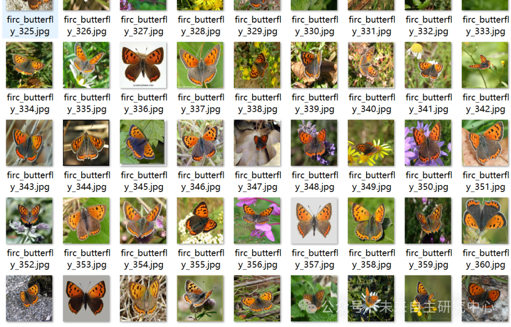
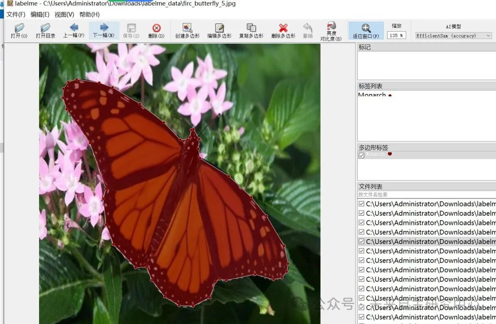

# Multiple Butterfly Identification and Segmentation Dataset in LabelMe format: 784 images, 9 categories

Dataset format: labelme format (without mask files, only including jpg images and corresponding json files)

Number of images (number of jpg files): 784

Number of annotations (number of json files): 784

Label category count: 9

Annotation Category Names: ["Monarch", "Zebra Longwing", "Crimson-patched Longwing", "Common Buckeye", "American Cooper", "Mourning Cloak", "Giant Swallowtail", "Cabbage White", "Red Admiral"]

Number of boxes labeled in each category:

Monarch count = 155

Zebra Longwing count = 89

Crimson-patched Longwing count = 56

Common Buckeye count = 89

American Cooper count = 85

Mourning Cloak count = 92

Giant Swallowtail count = 88

Cabbage White count = 52

Red Admiral count = 84

Using labeling tool: labelme=5.5.0

Annotation rules: Draw polygons around the categories.

Important Notice: The dataset can be opened and edited using LabelMe. For JSON datasets, one must convert them into mask or Yolo formats for semantic segmentation or instance segmentation.

Special : This dataset does not guarantee the accuracy or precision of the trained models or weight files. The dataset is provided with accurate and reasonable annotations only.

Image Preview:

Annotation example:

## Payment

Here is a pay link on Stripe ( https://buy.stripe.com/3cs8yP7sY87d0vu9AB ). Please contact me lonlonago@foxmail.com after funding $89, and I will send you a complete data files , thank you!

